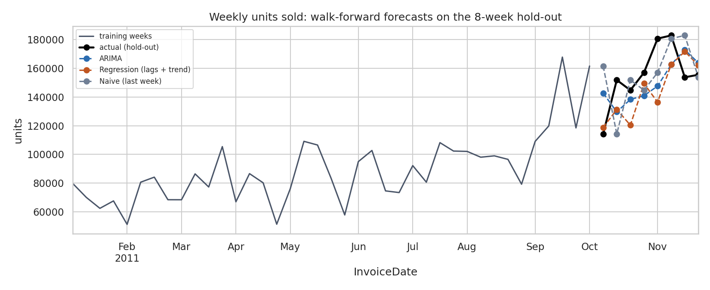
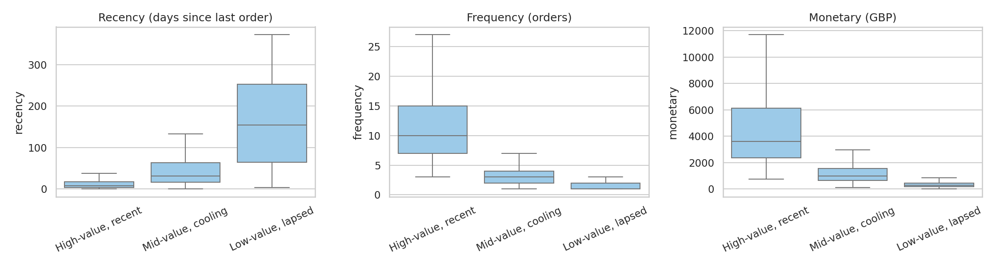

# Retail Sales Forecasting and Customer Segmentation

Exploratory analysis, weekly demand forecasting and RFM customer segmentation on a public retail transactions dataset.

**Stack:** Python, pandas, statsmodels (ARIMA), scikit-learn (regression, K-Means), SciPy (hypothesis tests), matplotlib, seaborn, Jupyter

**Data:** UCI *Online Retail* transactions, a UK online gift retailer that sells mostly to wholesalers (541,909 invoice lines, 1 Dec 2010 to 9 Dec 2011). It is downloaded automatically by `src/data.py`; the 45 MB file is not stored in this repo.

## What this project does

1. **Exploratory analysis** of seasonality, trends and anomalies.
2. **Forecasts weekly demand** with ARIMA and a regression baseline (plus a naive baseline), validated with walk-forward testing on an 8-week hold-out using MAE and RMSE.
3. **Segments customers** with RFM features and K-Means, chooses the number of clusters with silhouette scores, and tests whether the segments differ using hypothesis tests.

## Key findings

**Demand and seasonality**
- Monthly revenue sits between £0.5M and £0.73M from February to August, then climbs to a peak of **£1.44M in November**.
- There are **no Saturday transactions**, and Sunday is about half of a normal weekday.
- Anomalous days are flagged after removing the weekday pattern; the most extreme is 22 December 2010, just before the year-end closure.

**Forecasting** (weekly units, walk-forward on the last 8 weeks)

| Model | MAE | RMSE | MAPE |
|-------|-----|------|------|
| ARIMA(0,1,1) | 19,251 | **21,055** | 12.7% |
| Regression (lags + trend) | **18,250** | 21,878 | **11.3%** |
| Naive (last week) | 20,135 | 25,663 | 14.2% |

Both models beat the naive baseline, but **neither is clearly better**: ARIMA wins on RMSE and the regression wins on MAE and MAPE, and with only 8 held-out weeks the gap is within noise. The hold-out is the autumn ramp-up, which no model with one year of history can anticipate.



**Segmentation** (4,322 customers with a CustomerID)

| Segment | Customers | Avg. orders | Last order | Share of revenue |
|---------|-----------|-------------|------------|------------------|
| High-value, recent | 731 (17%) | 13.5 | 14 days ago | **66%** |
| Mid-value, cooling | 1,685 (39%) | 3.5 | 46 days ago | 26% |
| Low-value, lapsed | 1,906 (44%) | 1.3 | 163 days ago | 8% |

About 17% of customers produce two thirds of revenue.



**Hypothesis tests.** Differences in recency, frequency or spend would be circular, since the clusters were built to separate those. So the tests use two variables not used for clustering. Kruskal-Wallis shows both differ across segments (average items per order: p = 4.5e-74; cancellation rate: p = 7.4e-98) and every pairwise comparison is significant after Bonferroni adjustment. The effect sizes are **small to moderate** (epsilon squared 0.08 and 0.10).

## Choices worth knowing about

- **Weekly, not monthly, forecasting.** The data covers about 13 months, so a monthly series has too few points to validate. Weekly demand gives 47 usable weeks.
- **Fully cancelled orders are removed**, not just the cancellation row. Otherwise a 74,215-unit order cancelled within minutes would count as the biggest demand day of the year.
- **k = 3, not the best silhouette.** The silhouette is highest at k = 2 (0.434), which only separates active from lapsed customers. The search starts at k = 3, where k = 3 scores best (0.340). Full results are in `reports/silhouette_by_k.csv`.
- **ARIMA order** is chosen from the training weeks only: `d` from the Augmented Dickey-Fuller test, `p` and `q` by AIC.

## Project structure

```
src/data.py              download, cleaning, weekly series
src/eda.py               monthly, weekday, hourly profiles and anomaly detection
src/forecast.py          ARIMA, regression and naive walk-forward forecasting
src/segment.py           RFM, K-Means, silhouette, hypothesis tests
src/run_analysis.py      runs everything and writes reports/
notebooks/retail_analysis.ipynb   full walkthrough with outputs
reports/                 tables (csv) and figures
tests/                   unit tests
```

## Run it

```bash
pip install -r requirements.txt
python -m src.run_analysis      # downloads the data, writes reports/
python -m pytest
jupyter notebook notebooks/retail_analysis.ipynb
```

## Limitations

- **One year of data:** seasonality and growth cannot be separated, and the hold-out covers only 8 weeks.
- About **25% of lines have no CustomerID**, so they count as demand but are missing from the segmentation.
- The silhouette score for the chosen segmentation is modest (0.34): the groups are real but overlap.
- The retailer sells mostly to wholesalers, so results may not carry over to consumer retail.

## Data

UCI Online Retail dataset (Chen, Sain and Guo, 2012), loaded from a public copy in the [databricks/Spark-The-Definitive-Guide](https://github.com/databricks/Spark-The-Definitive-Guide) repository.
